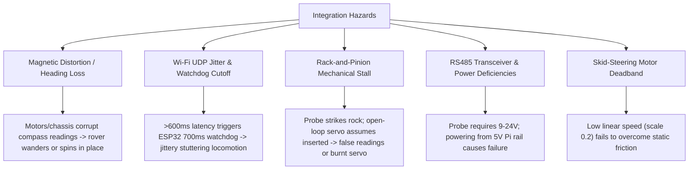

# Agrisarthi Rover: Technical Repository Audit & Hardware Integration Analysis

**Date:** 2026-11-15  
**Branch:** `hardware` (commit `3831c14`, tag: `sitl-v1`)  
**Target Environment:** ROS 2 Jazzy on Raspberry Pi 5 + ESP32-C6 Microcontroller + Modbus RS485 7-in-1 Soil Sensor + PC Base Station (Streamlit)

---

## 1. Executive Summary

The Agrisarthi repository contains a well-structured, modular, and fail-closed autonomous agricultural soil-sampling rover system. The repository currently possesses a fully functional **Software-In-The-Loop (SITL)** implementation verified with unit tests and a browser-based planner. The core navigation algorithms, strict mission validation, two-tier state machines, Modbus RTU register mapping, crash-safe atomic data persistence, and the ESP32 UDP session protocol are already implemented and test-covered.

However, **the system cannot currently run on physical rover hardware without completing critical driver, sensor, firmware, and launch integrations**. Most notably, there is **no heading/magnetometer ROS node** to supply `/heading_deg`, **no integrated GNSS driver node** in the launch files, the ESP32 firmware contains placeholder credentials and uncalibrated pin/actuator mappings, and the hardware configuration currently contains intentional placeholder values (`home_latitude: -999.0`).

---

## 2. Current Architecture & Data Flow

```mermaid
flowchart TD
    subgraph BaseStation["Base Station / Personal PC"]
        UI["Streamlit Field Planner (app.py)"]
        LocalMissions["Local Mission Storage (missions/)"]
    end

    subgraph Pi5["Raspberry Pi 5 (ROS 2 Jazzy)"]
        Bridge["rosbridge_server (WebSocket :9090)"]
        Mgr["mission_sampling_manager"]
        Nav["gps_waypoint_navigator (NavigationController)"]
        Soil["SoilSensor (RS485 Modbus RTU /dev/ttyUSB0)"]
        Store["Atomic JSON Storage (~/.../missions/data/)"]
    end

    subgraph ESP32["ESP32-C6 Microcontroller"]
        FW["Firmware (esp32c6_udp_motor_receiver.ino)"]
        FSM["Probe FSM (probe_fsm.h)"]
        Motors["Dual H-Bridge Motor Driver"]
        Servo["Rack-and-Pinion Probe Servo"]
        Switches["Limit Switches (Optional)"]
    end

    subgraph Sensors["Physical Sensors"]
        GNSS["UART GNSS Receiver"]
        Compass["IMU / Magnetometer (Missing Node)"]
        Probe["7-in-1 Soil NPK/pH/EC/Moist/Temp Probe"]
    end

    %% Network links
    UI <-->|WebSocket ws://:9090| Bridge
    Bridge <-->|/mission/waypoints_json\n/mission/start\n/mission/query| Mgr
    Bridge <-->|/gps/fix (map centering)| UI

    %% Internal ROS 2 topics
    Mgr -->|/mission/navigation_start| Nav
    Nav -->|/rover/nav_status| Mgr
    Nav -->|/probe/status| Mgr
    Mgr -->|/probe/command| Nav
    Mgr -->|/mission/waypoint_complete| Nav
    Mgr --> Soil
    Soil --> Store

    %% Sensor inputs
    GNSS -.->|/gps/fix| Nav
    GNSS -.->|/gps/fix| Mgr
    Compass -.->|/heading_deg (Clockwise from North)| Nav

    %% Hardware communication
    Nav <-->|UDP :5005 (ESP32Link)| FW
    FW --> Motors
    FW --> Servo
    Switches -.-> FW
```

### Component Details & Responsibilities

| Subsystem | Node / Module | Key Functions & Responsibilities |
| :--- | :--- | :--- |
| **PC Planner** | `rover_field_planner/app.py` | Farmer UI, boundary drawing, serpentine lawnmower waypoint path generator, mission JSON authoring, rosbridge client. Has zero ROS 2 dependencies. |
| **Mission Authority** | `mission_sampling_manager.py` | Fail-closed orchestrator. Validates missions, gates rover starts, monitors stopped velocity, commands probe insertion/retraction, runs RS485 Modbus acquisition on worker thread, atomically saves sample records, acknowledges waypoint completion. |
| **Navigation Authority** | `gps_waypoint_navigator.py` | Hosts `NavigationController` and `ESP32Link`. Tracks waypoints, computes heading error clockwise from North, applies speed scaling and turn-in-place logic, enforces geofence and sensor staleness timeouts, halts at waypoints. |
| **Core Navigation Logic** | `navigation_core.py` | Pure Python (ROS-independent). Haversine distance, WGS84 geodesic bearing, segment intersection checks, ray-casting point-in-polygon geofencing. |
| **Data Persistence** | `mission_data.py` | Validates strict schema `config/mission_data.schema.json`. Atomic replacement using temporary files and directory `fsync`. Prevents duplicate records and telemetry bloat. |
| **ESP32 Client Link** | `esp32_link.py` | Lightweight non-blocking UDP client. Session token handshake, 32-bit sequence tracking, idempotency-keyed probe commands, ack timeout detection. |
| **Soil Sensor Driver** | `soil_sensor.py` | Modbus RTU reader over `pyserial`. Function 0x03 read, CRC16 verification, register parsing (0x0000 for moisture/temp/EC/pH, 0x001E with 0x0004 fallback for NPK). Retries on corrupt frames. |
| **ESP32 Firmware** | `esp32c6_firmware/` | Wi-Fi UDP server (:5005), 700 ms motor watchdog, hard interlock (motors disabled unless probe is `RETRACTED`), probe FSM (`probe_fsm.h`), LEDC PWM motor and servo generation. |

---

## 3. Existing Working Functionality

The codebase has undergone substantial design hardening. All 36 ROS and unit tests pass cleanly:

1. **Deterministic Mission & Geofence Validation (`test_navigation_core.py`)**:
   - Rejects non-polygon, degenerate (< 1 m²), self-intersecting, or non-closed boundaries.
   - Enforces that all waypoints and the home point reside strictly inside the boundary.
   - Enforces unique waypoint IDs.
2. **Fail-Closed Navigation Safety**:
   - Stops immediately and latches if GPS fix or heading data is stale (> 1.0–2.0 s).
   - Detects geofence breach and commands immediate motor cutoff.
   - Turns in place when heading error > 55°; scales linear speed down proportionally as heading error increases up to 35° or as distance to waypoint decreases within 3.0 m.
   - Holds position at each waypoint until explicitly acknowledged by the sampling manager.
3. **Sampling Orchestration & Probe Interlock (`mission_sampling_manager.py`)**:
   - Gated start: rover cannot move until the manager verifies the probe is in `RETRACTED` state (`boot_safe`).
   - Stationary sampling: probe insertion is triggered only after ESP32 telemetry confirms zero motor velocity.
   - Thread-isolated Modbus acquisition: prevents blocking the ROS 2 node executor.
   - Strict sensor fallback: queries NPK register `0x001E`, falls back to `0x0004` if zero or absent. Rejects all-zero NPK readings as failures.
   - Crash-safe atomic persistence: writes to temporary file, flushes file descriptor, fsyncs parent directory, and atomically renames.
4. **ESP32 UDP Session Protocol (`esp32_link.py`, `esp32_protocol.h`, `probe_fsm.h`)**:
   - New random 64-bit session token generated on Pi startup; ESP32 detects session change, resets sequence counters, and stops motors.
   - 32-bit sequence wrap-around handling tested and verified.
   - Idempotent probe command handling using 32-slot ring buffer history.
   - Probe state machine transitions tested: `IDLE` -> `INSERTING` -> `INSERTED` -> `RETRACTING` -> `RETRACTED` / `ERROR`.
   - Host-side C++ test suites pass (`esp32_protocol_test.cpp`, `probe_fsm_test.cpp`).
5. **Laptop-Local SITL Demo**:
   - `simulation.launch.py` and Streamlit PC planner run completely locally without physical hardware using simulated ROS nodes.

---

## 4. Simulation-Only Components (SITL)

The following components exist solely for software simulation and must be kept isolated from hardware:

| Simulation Component | File Path | Mechanism |
| :--- | :--- | :--- |
| **Simulated Planar World** | `agrisarthi_gps_nav/simulated_world.py` | ROS node integrating 2D kinematics from simulated ESP32 velocity feedback; publishes `/sim/gps/fix` and `/sim/heading_deg`. Supports fault injection (`GPS_LOSS`). |
| **Simulated ESP32 Node** | `agrisarthi_gps_nav/simulated_esp32.py` | ROS node emulating ESP32 JSON UDP packets over ROS topics `/sim/esp32/command` and `/sim/esp32/feedback`. Simulates probe travel delays and motor watchdogs. |
| **ROS Sim ESP32 Link** | `ROSSimulatedESP32Link` in `simulated_esp32.py` | Adapter replacing `ESP32Link` inside `gps_waypoint_navigator.py` when `esp32_transport == 'ros_sim'`. |
| **Simulated Soil Sensor** | `agrisarthi_gps_nav/simulated_soil_sensor.py` | Deterministic synthetic generator of soil metrics (N, P, K, pH, moisture, temp, EC) with fault injection (`FAIL_NEXT_READS`). Never opens serial ports. |
| **SITL Launch & Config** | `launch/simulation.launch.py`, `config/simulation.yaml` | Connects the simulated nodes to the core navigator and manager. |
| **SITL Scripts** | `scripts/start_ros.sh`, `scripts/start_pc.sh` | Spawns tmux session for simulation and rosbridge; runs Streamlit with `AGRISARTHI_SITL_DEMO=1`. |

---

## 5. Missing Hardware Implementations & Critical Gaps

The following hardware implementations and configurations are currently **absent or incomplete** in the repository:

### 1. Heading / Compass / Magnetometer Node (BLOCKING)
- **Problem:** `gps_waypoint_navigator` requires a calibrated `/heading_deg` topic (`std_msgs/Float32`) giving true or magnetic degrees clockwise from North [0.0..360.0]. The node checks staleness with a 1.0 s timeout.
- **Current Status:** **There is NO ROS 2 node in the repository to read any physical magnetometer or IMU** (e.g. BNO055, HMC5883L, QMC5883L, WT901, MPU9250).
- **Impact:** On hardware launch, navigation will immediately halt and remain permanently stuck in `WAITING_FOR_SENSORS`.

### 2. Physical GNSS Driver Node (BLOCKING)
- **Problem:** `hardware.launch.py` only launches `gps_waypoint_navigator` and `mission_sampling_manager`. It does **not** launch any GNSS driver.
- **Current Status:** Documentation suggests running `nmea_navsat_driver` manually in a separate terminal.
- **Impact:** Hardware launch does not provide `/gps/fix` out of the box.

### 3. ESP32-C6 Firmware Configuration & Networking (BLOCKING)
- **Problem:** `esp32c6_firmware/esp32c6_udp_motor_receiver.ino` contains unconfigured placeholders:
  - `WIFI_SSID = "REPLACE_WITH_WIFI_SSID"`
  - `WIFI_PASSWORD = "REPLACE_WITH_WIFI_PASSWORD"`
  - DHCP is used without a fixed IP address. `hardware.yaml` expects `esp32_ip: 192.168.1.50`.
  - GPIO pin numbers (`LEFT_PWM_PIN=4`, etc.) and H-bridge direction logic are marked as examples only.
  - Servo travel angles (`PROBE_INSERT_ANGLE=120`, `PROBE_RETRACT_ANGLE=30`) are arbitrary examples that have not been mechanically calibrated.
  - Limit switches are disabled (`USE_PROBE_LIMIT_SWITCHES = false`), meaning probe position is purely timed.

### 4. Hardware Parameters Configuration (`hardware.yaml`)
- `home_latitude: -999.0` and `home_longitude: -999.0` are placeholder coordinates that will deliberately cause `mission_sampling_manager` to reject any mission lacking an embedded `home_point`.
- `sensor_port: /dev/ttyUSB0` uses an unstable dynamic device name rather than a persistent udev path (e.g., `/dev/serial/by-id/...`).
- `return_home` is not specified in `hardware.yaml` (defaults to `False` in Python).

### 5. Automated Hardware Startup & Rosbridge
- There is no unified hardware launch script (comparable to `scripts/start_ros.sh`) that starts the hardware ROS nodes, GNSS driver, heading publisher, and `rosbridge_server` simultaneously.

---

## 6. Hardware Configuration Requirements Matrix

| Parameter / Setting | File / Component | SITL Value | Hardware Requirement / Target | Notes |
| :--- | :--- | :--- | :--- | :--- |
| `gps_topic` | `hardware.yaml` | `/sim/gps/fix` | `/gps/fix` | Supplied by GNSS driver (`sensor_msgs/NavSatFix`). |
| `heading_topic` | `hardware.yaml` | `/sim/heading_deg` | `/heading_deg` | Supplied by compass/IMU (`std_msgs/Float32` 0..360° CW from N). |
| `esp32_ip` | `hardware.yaml` | N/A (`ros_sim`) | `192.168.1.50` (or local static IP) | ESP32 must have static IP or DHCP lease reservation. |
| `esp32_port` | `hardware.yaml` | N/A | `5005` | Matches `UDP_PORT` in firmware. |
| `esp32_transport` | `hardware.yaml` | `ros_sim` | `udp` (default) | Explicitly set `udp` in `hardware.yaml`. |
| `home_latitude` | `hardware.yaml` | `37.4219999` | Surveyed field latitude | Must be valid WGS84 coordinate. |
| `home_longitude` | `hardware.yaml` | `-122.0840575` | Surveyed field longitude | Must be valid WGS84 coordinate. |
| `sensor_mode` | `hardware.yaml` | `simulation` | `hardware` (default) | Opens real serial port. |
| `sensor_port` | `hardware.yaml` | `/dev/DO_NOT_OPEN...` | `/dev/serial/by-id/...` | Stable udev path to USB-RS485 transceiver. |
| `sensor_baudrate` | `hardware.yaml` | `4800` | `4800` | 8N1 default for standard Modbus 7-in-1 probes. |
| `sensor_slave_id` | `hardware.yaml` | `1` | `1` | Factory default for probe. |
| `data_directory` | `hardware.yaml` | `/tmp/agrisarthi_sitl/...` | `/home/pi/agrisarthi_ws/missions/data` | Ensure path exists and is writable on Pi. |
| `WIFI_SSID` | Firmware `.ino` | N/A | Dedicated Rover AP SSID | Low latency private network. |
| `WIFI_PASSWORD` | Firmware `.ino` | N/A | Dedicated Rover AP Pass | Keep offline/private. |
| `PROBE_SERVO_PIN` | Firmware `.ino` | `3` | Actual board GPIO | Calibrate pulse width against servo model. |
| Motor Pins | Firmware `.ino` | `4, 5, 6, 7` | Actual H-Bridge GPIOs | Calibrate PWM frequency and truth table. |

---

## 7. Potential Integration Problems & Risk Analysis



### Risk Breakdown:

1. **Heading Distortion from DC Motors and Steel Frame**:
   - High current through motor drivers generates magnetic fields that distort magnetometers.
   - *Mitigation:* Mount IMU on elevated mast away from battery and motor wires; perform 2D/3D hard-iron and soft-iron calibration.
2. **Wi-Fi Jitter & UDP Watchdog Stops**:
   - The ESP32 watchdog interval is 700 ms; `gps_waypoint_navigator` command rate is 10 Hz (100 ms).
   - If public/congested Wi-Fi is used, packet drop bursts will repeatedly cause the ESP32 to cut power and the navigator to pause with `COMMUNICATION_LOSS`.
   - *Mitigation:* Pi 5 should run its own hostapd Wi-Fi Access Point (5 GHz or clean 2.4 GHz channel); ESP32 connects directly to Pi AP.
3. **Probe Mechanical Resistance & Lack of Limit Switches**:
   - The probe FSM currently operates in open-loop timed mode (`USE_PROBE_LIMIT_SWITCHES = false`).
   - If the soil is hard or compacted, the servo may fail to push the probe into the ground, but firmware will still report `INSERTED` after 2.1 s. The sensor will read ambient air or surface debris.
   - *Mitigation:* Calibrate travel distance and consider wiring physical limit switches or implementing current sensing before deployment.
4. **RS485 Power & Signal Polarity**:
   - Modbus 7-in-1 probes typically require 9–24 V DC (12 V recommended). Connecting them to the Pi’s 5 V rail will cause intermittent or failed Modbus responses.
   - Swapped A and B RS485 lines cause silent failure (timeouts).
   - *Mitigation:* Power probe from regulated 12 V step-up/buck converter; verify A/B polarity with multimeter (A is typically non-inverting / positive idle).
5. **Differential Drive Skid-Steer Deadband**:
   - The controller applies `minimum_speed_scale: 0.2` (20% PWM) during tight turns or when approaching waypoints.
   - Most DC motors with gearboxes have a static friction threshold around 15–30% PWM where they stall.
   - *Mitigation:* Bench-test minimum start PWM and adjust `minimum_speed_scale` or motor driver parameters accordingly.

---

## 8. Concrete Implementation Plan: Converting SITL to Real Hardware

The transition from SITL to physical hardware must be executed incrementally in phases to avoid hardware damage.

### Phase 1: ESP32 Firmware Bench Verification (Drive Wheels Raised)
- **Goal:** Verify communication protocol, safety watchdog, and motor/servo interlock without rover movement.
- **Tasks:**
  1. Configure `WIFI_SSID`, `WIFI_PASSWORD`, and static IP allocation (`192.168.1.50`) in firmware.
  2. Flash ESP32-C6 using Arduino IDE / ESP-IDF with `esp32c6_udp_motor_receiver.ino`.
  3. Validate GPIO pinouts and H-bridge direction truth table for the specific motor driver (e.g., L298N, Cytron MDD10A, BTS7960).
  4. Perform test with `agrisarthi_gps_nav/test/test_esp32_link.py` over real Wi-Fi link.
  5. Verify watchdog: kill the test client while motors are spinning; confirm PWM shuts down within 700 ms.
  6. Verify probe interlock: trigger `PROBE_INSERT`; confirm motor commands are rejected while probe is not `RETRACTED`.

### Phase 2: Sensor Bring-Up on Raspberry Pi 5
- **Goal:** Establish reliable real-world data streams for GPS, heading, and soil measurements.
- **Tasks:**
  1. **GNSS Receiver:**
     - Connect UART GNSS receiver to Pi 5 (3.3 V UART or USB-UART adapter).
     - Configure baud rate (default 9600 or 115200) and verify NMEA stream with `minicom` or `picocom`.
     - Test `nmea_navsat_driver` node and confirm `/gps/fix` receives valid WGS84 coordinates.
  2. **Compass / Heading Publisher:**
     - Connect physical magnetometer/IMU to Pi 5 (I2C or UART).
     - Deploy a lightweight, calibrated ROS 2 node to publish `std_msgs/Float32` degrees clockwise from North [0..360°] on `/heading_deg`.
     - Perform field rotation test: ensure 0° = North, 90° = East, 180° = South, 270° = West.
  3. **RS485 Soil Sensor:**
     - Connect probe to 12 V power and USB-RS485 dongle.
     - Identify stable device path: `ls -l /dev/serial/by-id/`.
     - Run standalone Python test calling `SoilSensor.read()`; verify moisture, temp, EC, pH, and NPK registers return plausible values.

### Phase 3: Hardware Launch Configuration & Integration
- **Goal:** Create unified hardware launch infrastructure.
- **Tasks:**
  1. Update `config/hardware.yaml`:
     - Set exact surveyed `home_latitude` and `home_longitude`.
     - Set `sensor_port` to `/dev/serial/by-id/...`.
     - Set `esp32_ip: 192.168.1.50`, `esp32_transport: udp`.
     - Set `return_home: true` or `false` based on mission preference.
  2. Create a comprehensive `hardware.launch.py`:
     - Launch `gps_waypoint_navigator` and `mission_sampling_manager`.
     - Include GNSS driver node (`nmea_serial_driver`).
     - Include Heading/Compass driver node.
  3. Create hardware runner script `scripts/start_hardware.sh` (modeled after `start_ros.sh` but launching hardware stack and rosbridge).

### Phase 4: Tethered / Raised Wheel Ground Test
- **Goal:** Full end-to-end integration test with physical hardware off the ground.
- **Tasks:**
  1. Start `hardware.launch.py` and `rosbridge_server` on Pi.
  2. Launch Streamlit UI on PC with `AGRISARTHI_GPS_TOPIC=/gps/fix` and `AGRISARTHI_SITL_DEMO=0`.
  3. Verify GPS lock appears on Streamlit map.
  4. Submit small 2-waypoint test mission around current rover position.
  5. Verify `MISSION_READY` state and probe `RETRACTED` state.
  6. Send `START` command: verify motor directions (forward, reverse, turn clockwise/counter-clockwise).
  7. Manually simulate waypoint arrival by feeding nearby coordinate or testing tolerance.
  8. Verify full sampling cycle: rover stops -> probe inserts -> RS485 reads -> atomic JSON file updates -> probe retracts -> next waypoint activates.

### Phase 5: Field Deployment
- **Goal:** Safe autonomous operation in agricultural field.
- **Tasks:**
  1. Keep an independent physical emergency stop switch wired directly into motor driver power.
  2. Survey boundary corners and home location.
  3. Generate lawnmower path with adequate spacing.
  4. Execute mission under manual supervision; confirm sample document `mission_<id>_samples.json` adheres strictly to `mission_data.schema.json`.

---

## 9. Recommendation & Next Steps

Before making any changes to files, the following decisions are needed:
1. **Compass/Heading Sensor Choice:** What IMU/magnetometer model will be used (e.g., BNO055, HMC5883L, QMC5883L, WT901, or external RTK dual-antenna GNSS)? We need to create or configure the ROS 2 heading driver node accordingly.
2. **GNSS Model & Connection:** What GNSS receiver is attached to the Pi (USB or UART GPIO)? We will integrate the appropriate ROS 2 driver into `hardware.launch.py`.
3. **ESP32 Pinout & Driver Specs:** What H-bridge model and pin assignments are used on the physical chassis?
4. **Soil Sensor Device Path:** Confirm the USB-RS485 dongle identifier on the Pi (`/dev/serial/by-id/...`).
5. **Approval:** Awaiting user approval to proceed with Phase 1 and Phase 2 implementations.